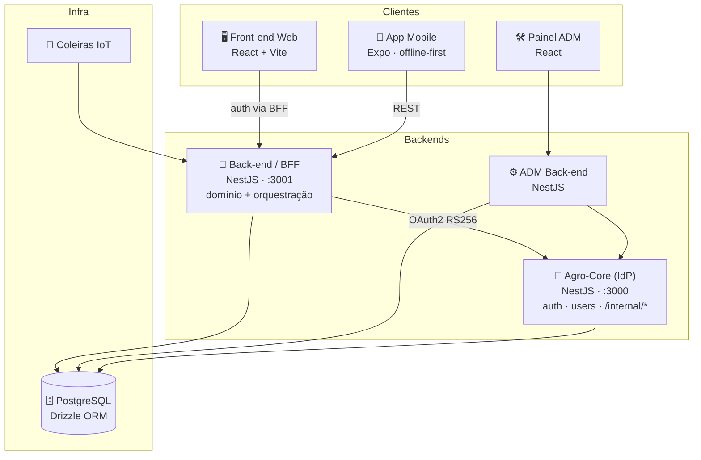

<div align="center">


# 🐂 Leite Fácil

### Plataforma de gestão pecuária leiteira — do campo ao financeiro

*Ecossistema completo para manejo de rebanho, reprodução (IATF), sanidade,*
*produção leiteira, IoT de coleiras e faturamento.*

<br/>


<br/>


</div>

---

## 🌱 O que é o Leite Fácil

O **Leite Fácil** é uma plataforma SaaS para produtores e veterinários gerenciarem
a operação leiteira de ponta a ponta: cadastro e manejo de animais, protocolos de
inseminação (**IATF**), controle sanitário, registro de produção, dietas, relatórios
analíticos, coleiras IoT de monitoramento e o ciclo financeiro (assinaturas e
cobrança). A arquitetura é composta por serviços independentes que conversam entre si
através de um **BFF** central, com identidade e autenticação isoladas em um
**Identity Provider** próprio.

---

## 🏗️ Arquitetura



> A autenticação do front passa **pelo BFF (`:3001`)**; o **Agro-Core** expõe apenas
> rotas `/internal/*` para os back-ends, nunca diretamente para os clientes.

---

## 📦 Serviços do ecossistema

| Repositório | Papel | Stack |
|---|---|---|
| 🔐 **`Agro-Core`** | Identity Provider standalone — auth, identidade e *user management* (`:3000`) | NestJS · BullMQ · class-validator |
| 🧩 **`leite-facil-back-end`** | Back-end de domínio + BFF — regra de negócio e orquestração (`:3001`) | NestJS · Drizzle ORM · PostgreSQL |
| 🖥️ **`leite-facil-front-end`** | Aplicação web principal do produtor/veterinário | React · Vite · TanStack Query · Sentry |
| 📱 **`leite-facil-mobile`** | App de campo offline-first (sincronização automática) | Expo SDK · React Native · TanStack Query |
| 🛠️ **`leite-facil-adm-back-end`** | Back-end do painel administrativo | NestJS · Drizzle · Neon |
| 🎛️ **`leite-facil-adm-front-end`** | Painel administrativo (gestão interna) | React · React Router · Tailwind |
| 📡 **`leite-facil-coleiras`** | Integração das coleiras IoT de monitoramento | — |
| 🧪 **`leite-facil-e2e`** | Testes end-to-end do ecossistema | Node · pg |
| 📄 **`edital`** | Documentação / material de apoio | — |

---

## 🧰 Stack & padrões

<div align="center">

| Camada | Tecnologias |
|---|---|
| **Back-end** | NestJS · TypeScript · Drizzle ORM · PostgreSQL · BullMQ |
| **Front-end** | React · Vite · TanStack Query · Tailwind · Radix UI · Hugeicons |
| **Mobile** | Expo · React Native · AsyncStorage (offline-first) |
| **Auth** | OAuth 2.0 · JWT **RS256** (public key) · class-validator |
| **Observabilidade** | Sentry |
| **Qualidade** | ESLint (`--max-warnings 0`) · Husky · lint-staged · testes E2E |

</div>

**Convenções do ecossistema**

- 🔑 Autenticação via **OAuth 2.0 / JWT RS256**, validação com **class-validator** (não Zod).
- 🧭 Em conflitos de contrato **front × back, o back é a fonte da verdade**.
- 🧹 Sem resíduo legacy: migrações e refatorações são feitas de uma vez (com backup).
- ✅ Pre-commit roda **lint-staged + ESLint sem tolerância a warnings**.

---

## 🚀 Áreas do produto

```
🐄 Manejo de rebanho      🧬 Reprodução / IATF        💉 Sanidade & diagnósticos
🥛 Produção leiteira      🥗 Dietas & nutrição        📊 Relatórios analíticos
📡 Coleiras IoT           💳 Faturamento & assinaturas 👥 Multiusuário (produtor/vet)
```

---

<div align="center">

### 🔒 Repositórios internos

Este é o perfil interno da organização **Leite Fácil**.
O código é privado — o acesso é restrito aos membros da equipe.

<sub>Feito com 🐂 para o campo · © Leite Fácil</sub>

</div>
